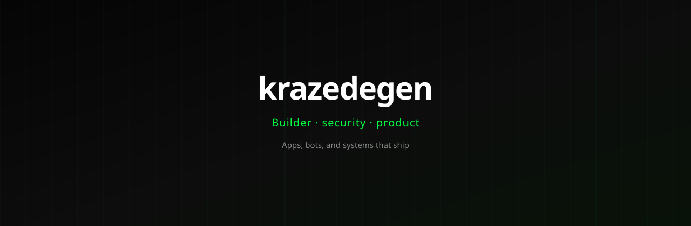
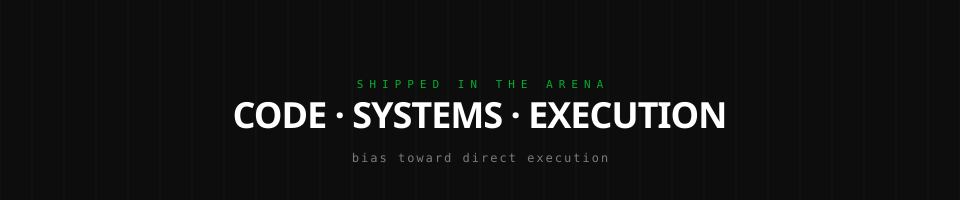

**Builder · security · product**

I design and ship software — mobile apps, bots, dashboards, and on-chain tooling.

 

---

## About

I work across the stack with a bias toward useful software that actually ships: Android products, automation, trading tooling, and edge/device projects.

**Focus areas:** Python · Kotlin / Android · Node · Vue / TypeScript · Sonic · Raspberry Pi

---

| Project | Summary | Stack |
|:--|:--|:--|
| **[obd-dashboard](https://github.com/krazedegen/obd-dashboard)** | Live OBD2 dashboard for cars on a Pi (gauges, Ford PIDs, kiosk mode) | Python · Flask · Pi |
| **[LetsGetIt](https://github.com/krazedegen/LetsGetIt)** | Android health app with goals, coaching chat, and premium flows | Kotlin · Jetpack |
| **[XAHBot](https://github.com/krazedegen/XAHBot)** | Telegram bot for live ledger data (fees, accounts, transactions) | Node · WebSocket |
| **[routecreate](https://github.com/krazedegen/routecreate)** | Pathfinding for arbitrage across fragmented DEX liquidity | Python |
| **[Compile-Codebase](https://github.com/krazedegen/Compile-Codebase)** | Pack a whole codebase into one clean text file for sharing / AI | Python · CLI |
| **[OpenBible](https://github.com/krazedegen/OpenBible)** | Bible study web app — search, maps, assistant | Vue 3 · TypeScript |

Also: multi-tenant SaaS (`LocksmithAssist`), trading tools, and smaller experiments under this handle.

---

  
  
  
  
  
  
  
  

